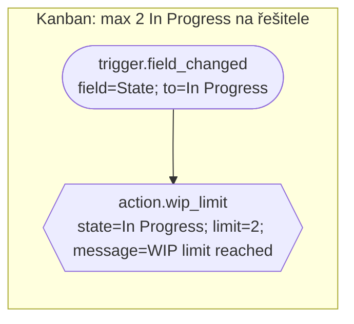
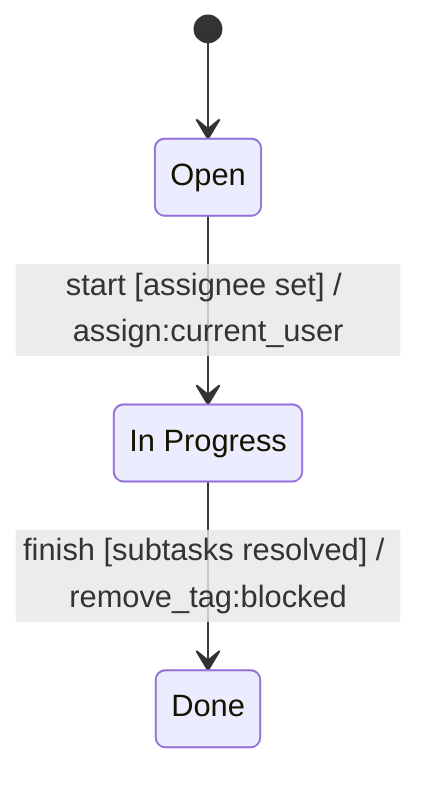

# Konverzní tabulka: Mermaid ⇄ nástroje YouTrack pro workflow

Cíl: Claude nakreslí proces v Mermaidu → deterministický překladač ho převede na `WorkflowSpec` (bloky) → validace → simulace → export / nasazení do YouTrack.
Mermaid je **jazyk pro popis a schválení**, `WorkflowSpec` zůstává zdrojem pravdy (nese typované parametry, které Mermaid nemá).

Legenda stavu: ✅ hotovo v repozitáři · 🟡 částečně · ⬜ chybí · ❓ platí z dokumentace/paměti, **neověřeno na živém YouTrack**.

## A. Nástroje YouTrack pro tvorbu workflow → Mermaid konstrukce → náš blok

| # | Nástroj YouTrack (JS workflow API) | Mermaid forma | Cíl v `WorkflowSpec` / generovaný kód | Stav |
|---|---|---|---|---|
| A1 | **State-machine** (`entities.Issue.stateMachine`: stavy, přechody, guard, onEnter/onExit) ❓ | `stateDiagram-v2`: stavy, `A --> B : název [guard] / akce` | zatím překlad na `trigger.field_changed` + brány; cíl = nativní `stateMachine` modul (YouTrack ho pak sám zobrazí jako diagram) | 🟡 |
| A2 | **On-change rule** (`Issue.onChange`: `guard`, `action`, `requirements`) | `flowchart`: stadium → (kosočtverec)* → obdélník(y) uvnitř `subgraph` | `rules[]`: `when` / `if` / `then` | ✅ |
| A3 | **Scheduled rule** (`Issue.onSchedule`: `search`, `cron`) | stadium s hodinami `⏱`, parametry `cron=…; search=…` | `trigger.schedule_*` | ✅ |
| A4 | **Action rule** (`Issue.action` – příkaz v menu/ručně) ❓ | stadium `[/ ruční příkaz /]` | `trigger.manual_command` | ⬜ |
| A5 | **Podmínka / guard** (výraz v `guard`) | kosočtverec `{…}`, hrany `yes`/`no` | `condition.*`, vnoření `all_of/any_of/not` | ✅ |
| A6 | **Brána** (`workflow.check` – zablokuje uložení) | šestiúhelník `{{…}}` | `action.require_*`, `wip_limit`, `block` | ✅ |
| A7 | **Mutace issue** (`issue.fields.X = …`, `addTag`, `addComment`) | obdélník `[…]` | `action.set_field/assign/add_tag/add_comment/…` | ✅ |
| A8 | **Notifikace / zprávy** (`user.notify`, `workflow.message`) | rovnoběžník `[/…/]` | `action.notify`, `action.message` | ✅ |
| A9 | **Vyhledávání** (`search` modul, query) | kosočtverec s `search=` nebo parametr triggeru | `trigger.schedule_search`, `action.wip_limit` | 🟡 |
| A10 | **Vazby issue** (`issue.links[…]`, podúkoly) | obdélník s `link=` | `condition.*subtasks*`, `close_parent_*`; chybí `action.link_issue` | 🟡 |
| A11 | **HTTP volání** (`http` modul) ❓ | `sequenceDiagram` šipka YouTrack → Middleware | `action.request_external_check` / `http_call` | ⬜ |
| A12 | **Reakce na výsledek externí kontroly** (řetězení přes tag/pole) | podprogram `[[…]]` = „předání jinému pravidlu“ | `trigger.tag_added` | ⬜ |
| A13 | **Requirements** (typy a hodnoty polí) | `erDiagram` / `classDiagram` projektu | automaticky z použitých bloků + manifest; schéma projektu pro simulátor | 🟡 |
| A14 | **Skupiny / role** (`user.isInGroup`) | kosočtverec `group=QA` | `condition.current_user_in_group` | ✅ |

\* podmínky jsou volitelné.

## B. Mermaid konstrukce → co z ní překladač udělá

| Mermaid | Význam v konvenci | Výsledek | Kontrola |
|---|---|---|---|
| `---\ntitle: name\n---` (frontmatter) | název workflow | `name`, `title` | kebab-case |
| `subgraph rule_<id>["titulek"]` | **jedno pravidlo** | `rules[].id`, `.title` | unikátní id |
| stadium `(["…"])` | trigger | `when` | právě 1 na pravidlo |
| kosočtverec `{"…"}` | podmínka | `if[]` (hrana `yes`) | `no` větev → vygeneruje se inverzní pravidlo (`condition.not`), YouTrack nemá „else“ |
| obdélník `["…"]` | akce | `then[]` v pořadí šipek | pořadí = pořadí šipek |
| šestiúhelník `{{"…"}}` | brána (blokuje změnu) | `then[]` (gate action) | jen s change triggerem, ne s cron |
| rovnoběžník `[/"…"/]` | notifikace / zpráva | `then[]` | šablony `{{…}}` na whitelistu |
| podprogram `[["…"]]` | předání jinému pravidlu přes tag/pole | akce `add_tag` + v cílovém pravidle `trigger.tag_added` | musí existovat protistrana |
| válec `[("…")]` | externí systém / znalostní báze | `http`/external blok (až bude) | host na allowlistu |
| první řádek textu uzlu | **id bloku** (`action.set_field`) | `block` | musí existovat v katalogu |
| další řádky `klíč=hodnota; …` | **parametry** | `params` | zod schéma bloku |
| hrana `-->` | pořadí / tok | řazení | cyklus = chyba |
| hrana `-.->` | volitelné / dokumentační | ignoruje se | – |
| popisek hrany `\|yes\|` / `\|no\|` | větev podmínky | viz kosočtverec | obě větve vyřešené |
| `classDef` / `:::gate` | vizuální styl | ignoruje se (kontrola shody tvaru a typu bloku) | neshoda tvar≠blok = chyba |
| `%% komentář` | poznámka | ignoruje se | – |
| `stateDiagram-v2` `[*] --> Open` | počáteční stav | `initial` stavu | právě 1 |
| `state "In Progress" as InProgress` | stav s mezerou | hodnota pole `State` = `In Progress` | musí být v poli projektu |
| `A --> B : popisek [guard] / akce` | přechod | `trigger.field_changed(State, from=A, to=B)` + podmínky + akce | guard/akce z katalogu |
| composite/`<<choice>>`/`<<fork>>` | složitější stavy | zatím **zamítnout** s vysvětlením | ⬜ |

### Příklad (flowchart → jedno pravidlo)

→ `{ id: "wip-limit", when: { block: "trigger.field_changed", params: { field: "State", to: "In Progress" } }, then: [{ block: "action.wip_limit", params: {...} }] }`

### Příklad (stateDiagram → přechody)

## C. Cesty nasazení do projektu (každý uživatel si vybere)

| Cesta | Pro koho | Potřebuje | Stav |
|---|---|---|---|
| 1. **Export složky + vložení do Workflow editoru v UI** | kdokoli s právem správce projektu | nic dalšího, žádný token | ✅ export · ❓ import v UI |
| 2. **Import balíčku workflow** (zip/složka) ❓ | správce | formát balíčku podle verze YouTrack | ⬜ |
| 3. **REST API** (`deploy_workflow`) | tým s CI / automatizací | trvalý token, role s právem upravovat workflow | 🟡 jen mock server, dry-run výchozí |
| 4. **Claude přes MCP** (všechno výše v jednom kroku) | koncový uživatel | MCP server + env `YOUTRACK_URL`, `YOUTRACK_TOKEN` | ✅ nástroje · ❓ živý YouTrack |
| 5. **Zpětné ověření po nasazení** (přečíst workflow z API a porovnat s kompilátem) | všichni | čtecí přístup | ⬜ |

## D. Kde se zachytí které chyby („bezchybnost“ po vrstvách)

| Vrstva | Zachytí | Stav |
|---|---|---|
| 1. Parser Mermaidu (přísný podmnožinový) | syntaxe, neznámý tvar/hrana, cyklus, více triggerů v pravidle, tvar≠typ bloku | ⬜ |
| 2. Katalog bloků + zod | neexistující blok, špatné/chybějící parametry, nebezpečné řetězce | ✅ |
| 3. Sémantická validace | brána v cron pravidle, konflikt typů pole, duplicitní id, neúplná `no` větev | ✅ / 🟡 |
| 4. Schéma projektu (erDiagram nebo konfigurace) | pole/hodnota, která v projektu neexistuje | ✅ simulátor |
| 5. Simulace scénářů | chování, rollback bran, idempotence plánovačů, smyčky | ✅ |
| 6. Dry-run nasazení | co přesně se pošle | ✅ |
| 7. Zpětné čtení po nasazení | rozdíl mezi zamýšleným a nasazeným | ⬜ |
| 8. Zkouška na sandbox projektu YouTrack | skutečné chování API | ⬜ **nutné před produkcí** |

## E. Co je třeba doplnit, aby to byla celá cesta
1. `mermaid_to_spec` + `spec_to_mermaid` (parser podmnožiny, round-trip test na 17pravidlovém workflow).
2. Cíl kompilace `stateMachine` pro `stateDiagram-v2`.
3. Bloky `trigger.tag_added`, `action.request_external_check`, `action.link_issue`, `trigger.manual_command`.
4. `erDiagram` → schéma projektu pro simulátor a kontrolu polí.
5. Zpětné čtení nasazeného workflow + diff.
6. Jednorázové ověření bodů označených ❓ na sandbox projektu.
